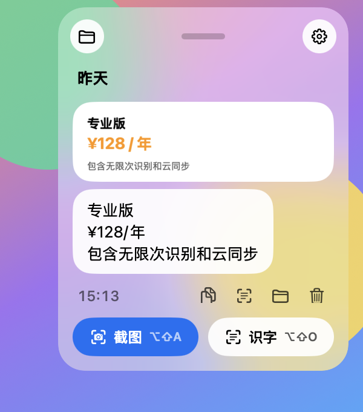

# ShotShelf

English | [简体中文](README.zh-CN.md)

A tiny macOS menu bar screenshot tool. Every capture goes straight to the clipboard and stays in a frosted-glass history panel, so you can always find it again. Add mosaic to hide details or copy text with offline OCR right while you capture. Free and open source.

<p>
  
  
</p>

## Features

- **Never lose a screenshot**: every capture is copied to the clipboard and saved to the history panel, grouped by day like a chat
- **Mark it up**: draw boxes, circles and freehand lines on the capture before you copy it
- **Hide details as you capture**: select an area, click Mosaic and drag over anything you want to cover
- **Copy text from the screen**: click OCR to recognize the text in the selection and copy it. Mixed Chinese and English text works, and everything stays on your Mac
- **Search your screenshots**: find a screenshot by a few words you remember, like part of an error message. Click the magnifying glass in the history or press `⌘F`
- **Drag to share**: drag any screenshot from the history into a chat, the desktop or any other app
- **Stays out of your way**: just a menu bar icon, no Dock icon, and about 30 MB of memory
- **English and Chinese UI**: follows your system language, and you can switch in Settings at any time without restarting
- Global shortcuts don't need Accessibility permission. On MacBooks with a notch, use the shortcut to open the panel if the notch hides the menu bar icon

## Download

Requires macOS 14 or later. Works on both Apple silicon and Intel Macs.

1. Download the latest `ShotShelf-x.y.z.dmg` from [Releases](https://github.com/stimQQ/ShotShelf/releases/latest)
2. Open the dmg and drag ShotShelf into Applications
3. Open ShotShelf from Applications. A viewfinder icon appears in the menu bar

The app is signed with a Developer ID and notarized by Apple, so it opens with a double-click.

## Build from source

Requires Xcode or the Command Line Tools (Swift 5.9 or later):

```bash
git clone https://github.com/stimQQ/ShotShelf.git
cd ShotShelf
./build.sh                      # builds build/ShotShelf.app
open build/ShotShelf.app        # drag it into Applications to keep it
```

`build.sh` signs with an Apple Development certificate from your keychain when it finds one, so screen recording permission survives rebuilds. Without a certificate it falls back to ad-hoc signing, and you need to turn ShotShelf off and on again in System Settings after every rebuild.

## First run

The first time you capture, follow the prompt in the panel: open System Settings › Privacy & Security › Screen & System Audio Recording, turn on ShotShelf, then click Relaunch in the panel. macOS 15 may also ask whether ShotShelf can access your screen directly. Choose Allow.

## Usage

| Action | Result |
|---|---|
| `⌥⇧A` | Capture: select an area, then use the toolbar to draw boxes, circles or freehand lines, add mosaic or copy text. Click Done to copy the image |
| `⌥⇧O` | Capture Text: select an area and its text is recognized and copied right away, without the toolbar |
| `⌥⇧S` | Open or close the screenshot history |
| Click the menu bar icon | Open the history. Click an image to copy it, or drag it out to share |
| Right-click the menu bar icon | Quick menu |

On the capture screen (the display freezes when you press the shortcut):

- Drag to select an area. Click without dragging to select the whole window under the pointer
- After selecting, drag the selection to move it, or drag the eight handles to resize it
- **Box, Circle and Pen**: pick a tool and drag inside the selection to draw in red. Hold Shift for a square or a perfect circle. Click the active tool again to go back to moving the selection
- **Mosaic**: turn it on and drag inside the selection to cover areas
- `⌘Z` undoes the last box, circle, line or mosaic
- **OCR**: recognize the text in the selection and copy it
- **Done**: copy the image. You can also press Return, press `⌘C` or double-click the selection
- `Esc` cancels. Right-click to clear the selection and start over

In the history panel, the folder button opens the screenshots folder, the magnifying glass searches the text in your screenshots, and the gear opens Settings (Language / 语言, Launch at Login, Quit). Drag the handle at the top to move the panel. It remembers where you put it.

Search matches every word you type, ignoring case, and shows the matching lines with the words highlighted. `Esc` clears the search, and pressing it again closes the search.

To make search work, ShotShelf reads the text in your screenshots in the background at low priority. The text only shows under a screenshot when you click OCR or choose Copy Text.

## Data and privacy

- Screenshots are saved in `~/Pictures/ShotShelf/`, and the history index in `~/Library/Application Support/ShotShelf/index.json`
- Text recognition uses Apple's built-in Vision framework and runs on your Mac. The recognized text is kept in the history index for search
- ShotShelf never connects to the internet and collects no data

## Development

```bash
swift build
.build/debug/ShotShelf --ocr some.png                                   # print the recognized text
SHOTSHELF_DIR=/tmp/x .build/debug/ShotShelf --snapshot out.png a.png   # render the history panel offscreen
.build/debug/ShotShelf --preview 5 a.png                                # show the real glass panel at the top right of the primary screen for a few seconds
.build/debug/ShotShelf --grab /tmp/x                                    # freeze every display and time it
.build/debug/ShotShelf --overlay-snapshot out.png full-screen@2x.png    # render the capture screen offscreen (with mosaic and toolbar)
```

Add `--en` or `--zh` to preview a language without saving the choice, and `--dark` for dark mode. Point `SHOTSHELF_DIR` at a scratch folder so debugging never touches your real screenshot history.

To build a release, run `./release.sh`. It builds a universal binary, signs it with a Developer ID, submits it to Apple for notarization and writes `dist/ShotShelf-<version>.dmg`. You need a Developer ID Application certificate in your keychain and a notarytool profile (see the comments at the top of the script). The app icon is generated by `swift tools/make-icon.swift`.

## License

[MIT](LICENSE)
